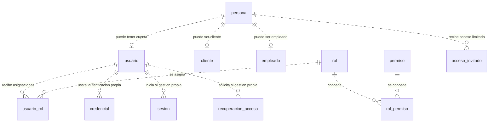
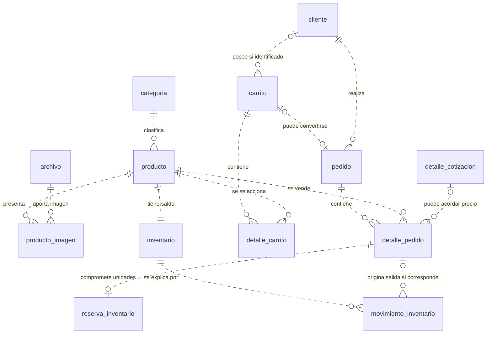
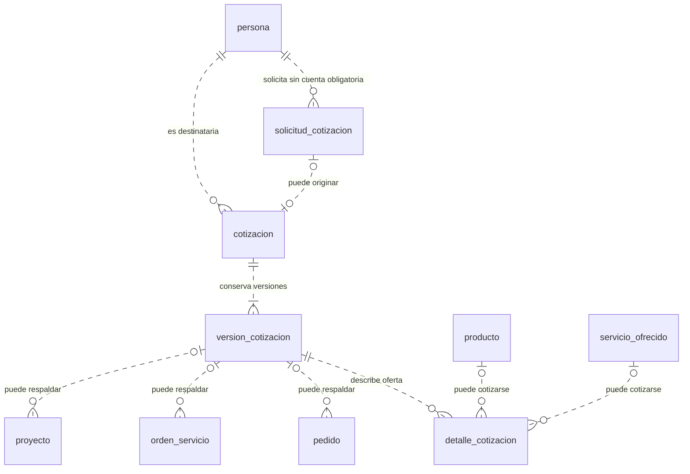
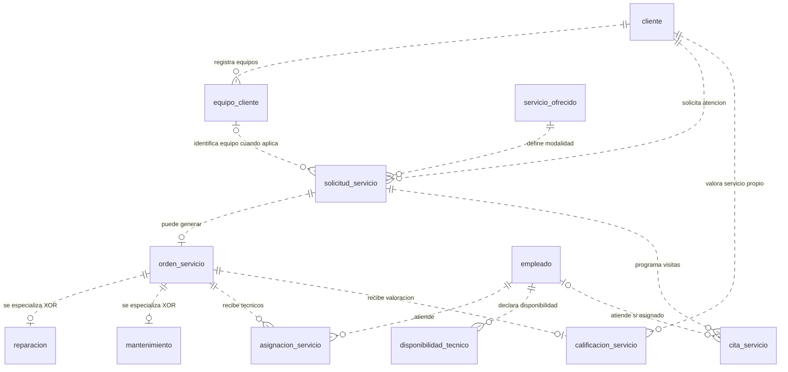
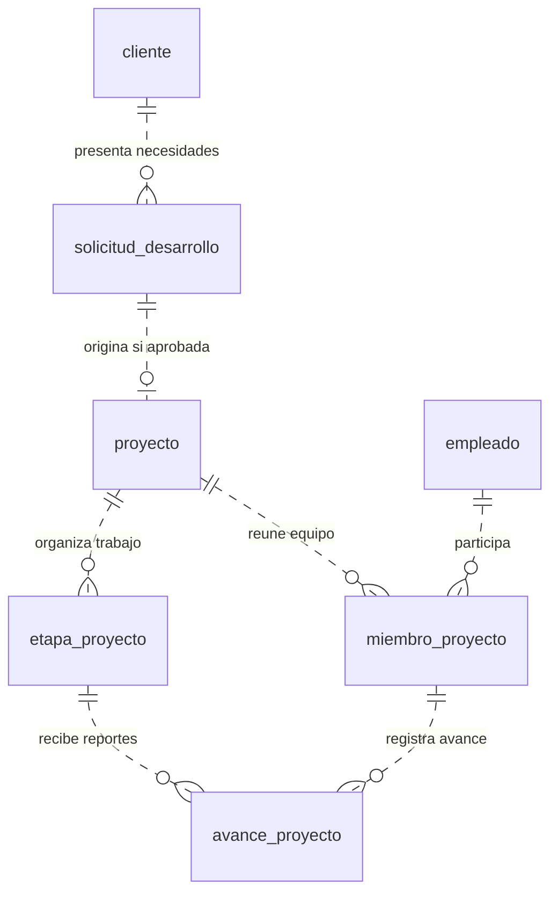
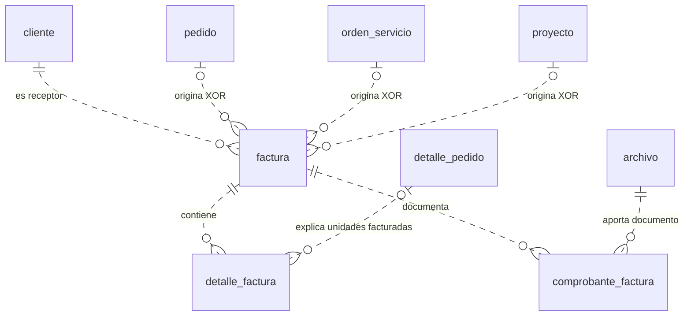
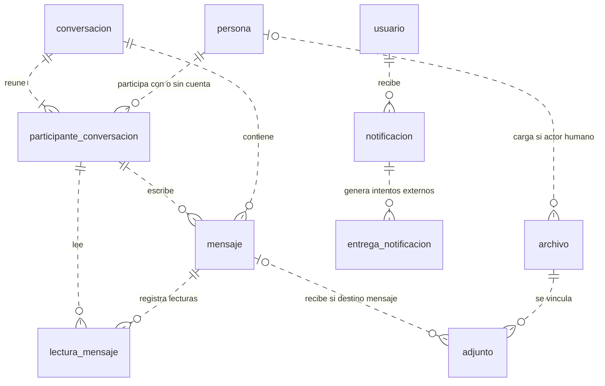

# Modelo conceptual de Systemic Tech & Support

FASE 2 · Propuesta para revisión · PostgreSQL · Base prevista: `systemic_tech_db`

Este documento define entidades, atributos de negocio, relaciones y cardinalidades. Su fuente principal es «Requerimientos - Systemic Tech.docx», leído íntegramente: RF-01 a RF-42, sin faltantes ni duplicados. Complementa la fase 1 y las instrucciones adicionales del proyecto. No contiene SQL ni fija todavía tipos PostgreSQL, PK, FK o el diccionario físico.

**Decisión confirmada por el usuario:** se podrá cotizar, comprar y solicitar reparaciones, mantenimientos y desarrollo de software sin crear una cuenta. La cuenta es opcional; la identificación comercial y la autorización para acceder a cada operación siguen siendo necesarias.

## 1 Decisiones y supuestos del modelo

| Decisión | Estado y alcance |
|---|---|
| Cuenta opcional para las operaciones de clientes | Confirmado por el usuario. No se crean cuentas ficticias para visitantes. |
| Datos de persona, cuenta, cliente y empleado separados | Propuesta. Evita duplicar la identidad de alguien que sea cliente y empleado, y permite clientes sin credenciales. |
| Clientes individuales con una persona de contacto | Supuesto inicial. Clientes empresariales con varias personas autorizadas requieren revisar esta cardinalidad antes de la fase 3. |
| Una ubicación de inventario | Supuesto inicial. No se introduce un módulo de almacenes. |
| Una categoría principal por producto | Supuesto inicial. No se presupone clasificación múltiple. |
| Reserva al confirmar pedido y salida al entregar | Propuesta operativa. Se incluye `reserva_inventario` para expresar ese compromiso sin descontar dos veces la existencia física. No presupone pago electrónico. |
| Una solicitud técnica genera como máximo una orden | Supuesto inicial. Puede tener varias citas y asignaciones de técnicos. |
| Reparación de un equipo; mantenimiento de un equipo o alcance descrito | Supuesto inicial. La reparación exige identificar el equipo; un mantenimiento sin equipo individual debe describir expresamente su alcance. |
| Una solicitud de software genera como máximo un proyecto | Supuesto inicial. Una solicitud rechazada no necesita proyecto. |
| Cotización con versiones | Propuesta. Una negociación conserva sus revisiones y la versión respondida por el cliente. |
| Una factura tiene un único origen principal | Propuesta: pedido, orden de servicio o proyecto. Se admite conceptualmente más de una factura por origen para permitir facturación parcial; reglas e importes pendientes. |
| Avance de proyecto mediante etapas ponderadas | Propuesta. El avance se deriva de los últimos reportes de sus etapas. |

`persona`, `reserva_inventario` y `acceso_invitado` son componentes de soporte de los módulos solicitados: identidad compartida, compromiso de existencias y acceso sin cuenta. No añaden nuevas líneas de negocio.

## 2 Cómo leer el modelo

Cada entidad posee un identificador conceptual, aunque no se repita en todas las filas. Los atributos enumerados son hechos relevantes del negocio; su obligatoriedad, tipos, claves y restricciones exactas se definirán en la fase 3. Las relaciones se describen separadamente para no confundirlas con columnas físicas.

Las fechas de creación y modificación se incorporarán donde exista información editable. Los datos derivados se indican expresamente. Los datos históricos de un documento representan lo acordado o emitido en ese momento, aunque después cambien los datos maestros.

El DER se presenta por áreas para facilitar su lectura. **Todos los diagramas forman un único modelo**: una entidad repetida en dos diagramas sigue siendo la misma entidad.

Notación: `||` exactamente uno; `o|` cero o uno; `o{` cero o muchos; `|{` uno o muchos. Las relaciones opcionales con varios tipos de origen se acompañan de reglas de exclusividad: las líneas por sí solas no expresan «exactamente uno entre varios». Se utiliza la [notación entidad-relación de Mermaid](https://mermaid.js.org/syntax/entityRelationshipDiagram.html).

## 3 Identidad y acceso

| Entidad | Propósito y atributos conceptuales principales |
|---|---|
| `persona` | Identidad/contacto de una persona: nombres, apellidos, correo de contacto, teléfono y estado. No exige cuenta ni documento de identidad para una consulta o cotización. |
| `usuario` | Cuenta opcional: identificador de acceso, correo de acceso, estado, fecha de alta, verificación y referencia al proveedor de autenticación cuando exista. El correo de acceso y el de contacto tienen funciones distintas. |
| `cliente` | Relación comercial: código de cliente, fecha de alta, estado y datos comerciales complementarios. Nombre y contacto actual se obtienen de la persona. |
| `empleado` | Participación laboral: código interno, fecha de vinculación, cargo descriptivo y estado. El cargo no concede permisos automáticamente. |
| `rol` | Código, nombre, descripción y estado de un rol de negocio. |
| `permiso` | Código de acción, descripción y recurso de negocio autorizado. |
| `usuario_rol` | Asignación de un rol: fecha de inicio, fecha de terminación opcional y asignador. |
| `rol_permiso` | Concesión de un permiso a un rol: fecha y concedente. |
| `acceso_invitado` | Autorización sin cuenta: medio de verificación, comprobación realizada, huella del secreto, emisión, vencimiento, revocación y alcance permitido. No se almacena el secreto en claro. |

Una persona puede tener cero o una cuenta, cero o un perfil de cliente y cero o un perfil de empleado. Los perfiles no se excluyen entre sí. Un empleado que opere en el sistema necesita una cuenta habilitada de esa misma persona.

Una persona que solo navega por el catálogo no requiere registro persistente. Al enviar una solicitud se conserva su contacto; al comprar o iniciar una relación comercial se crea el perfil de cliente necesario. Una cotización puede corresponder a una persona sin perfil de cliente y sin cuenta.

Los contactos no se fusionan ni se vinculan automáticamente a cuentas por coincidir en correo o nombre. La incorporación de operaciones anteriores a una cuenta exige verificar titularidad.

El acceso invitado se limita a un recurso concreto y a acciones autorizadas. Poder consultar un pedido no concede acceso a todas las operaciones de esa persona. La expiración de un enlace no elimina mensajes, pedidos ni evidencia histórica.

Entidades condicionadas a la arquitectura de autenticación:

| Entidad | Atributos y condición |
|---|---|
| `credencial` | Método, hash de contraseña y fecha de actualización. Solo si la aplicación gestiona contraseñas; inicialmente una credencial de contraseña activa por cuenta. |
| `sesion` | Inicio, vencimiento, revocación y huella del mecanismo de renovación, cuando se use. Solo si la aplicación mantiene sesiones propias. |
| `recuperacion_acceso` | Solicitud, huella del token, vencimiento y consumo. Solo si no lo resuelve el proveedor elegido. |

Estas tres entidades describen necesidades conceptuales alternativas; no autorizan duplicar una gestión de autenticación ya resuelta por Supabase u otro proveedor.

## 4 Productos inventario y pedidos

| Entidad | Propósito y atributos conceptuales principales |
|---|---|
| `categoria` | Nombre, descripción y estado de publicación. |
| `producto` | Código o SKU, nombre, descripción, precio vigente, moneda, unidad de medida y estado comercial. La disponibilidad es derivada. |
| `producto_imagen` | Asociación con archivo: orden de presentación, texto alternativo e indicación de imagen principal. |
| `inventario` | Saldo físico operativo del producto, fecha de actualización; reservado y disponible se derivan. |
| `movimiento_inventario` | Tipo entrada/salida/ajuste, variación de cantidad, fecha, motivo, responsable humano o sistema y referencia a la operación que lo origina cuando exista. |
| `reserva_inventario` | Cantidad comprometida, estado, creación, cierre y motivo de liberación. Pertenece a un detalle de pedido. |
| `carrito` | Creación, última actividad, estado e identificador protegido de sesión anónima cuando aún no tenga cliente asociado. |
| `detalle_carrito` | Cantidad solicitada del producto. Los precios mostrados se recalculan; no constituyen todavía condiciones de venta. |
| `pedido` | Número comercial, fecha, estado, moneda, datos históricos del comprador/contacto y fecha de finalización. |
| `detalle_pedido` | Número de línea, descripción vendida, cantidad, unidad, precio unitario acordado y condiciones económicas aplicadas. Subtotal derivado. |

Relaciones y reglas:

- Una categoría contiene cero o muchos productos; cada producto tiene una categoría principal.
- Cada producto tiene un registro de inventario. Sus movimientos explican el saldo físico completo, incluido el saldo inicial.
- Un carrito pertenece a un cliente identificado o a una sesión anónima, nunca queda accesible mediante un identificador predecible. Un carrito puede originar como máximo un pedido; un pedido puede crearse sin carrito por atención administrativa.
- Un pedido pertenece a exactamente un cliente comercial, que puede no tener cuenta. Admite cero líneas mientras sea borrador y exige al menos una al confirmarse.
- Cada detalle de pedido corresponde a un producto. Puede conservar referencia a una línea cotizada, cuando su precio proceda de una cotización aceptada.
- Se propone como máximo una reserva por detalle de pedido. Una confirmación satisfactoria reserva toda la cantidad vendida. Se revalida la disponibilidad dentro de la operación que confirma el pedido.
- **Existencia física = suma de movimientos. Reservado = suma de reservas activas. Disponible = existencia física menos reservado.** El saldo de `inventario` es una proyección controlada de los movimientos, no otra fuente independiente.
- Al entregar se registra la salida y se consume la reserva en la misma operación. Al cancelar antes de entregar se libera la reserva, sin inventar una entrada física. El flujo inicial no contempla entregas parciales.
- Las salidas de venta se vinculan al detalle concreto de pedido. Entradas y ajustes independientes identifican su motivo y responsable; no requieren un pedido ficticio.
- No se propone aquí un flujo de devolución después de la entrega. Una corrección de inventario debe representar lo sucedido físicamente y conservar el historial.
- Los actores automáticos identifican el sistema responsable; los actores humanos identifican la persona. La ejecución técnica también se conserva en auditoría.

La reserva es una decisión propuesta para revisión. Si el negocio registra ventas solo cuando entrega físicamente, se podrá simplificar esta parte antes de implementar.

## 5 Cotizaciones

| Entidad | Propósito y atributos conceptuales principales |
|---|---|
| `solicitud_cotizacion` | Necesidad presentada, fecha, estado y nombre/correo/teléfono suministrados en esa solicitud como evidencia histórica. |
| `cotizacion` | Número comercial, fecha de apertura y estado general de la negociación. |
| `version_cotizacion` | Número de versión, moneda, condiciones, vigencia, datos del destinatario, preparación, fecha de envío, decisión, fecha y evidencia de respuesta. |
| `detalle_cotizacion` | Línea, clase de concepto, descripción ofrecida, cantidad, unidad, precio, descuentos e impuestos acordados si corresponden. Importes derivados. |

Una persona puede presentar numerosas solicitudes sin cuenta. Una solicitud genera cero o una cotización, y la cotización conserva una o más versiones. Se admite cotización creada directamente por personal autorizado, sin solicitud previa; toda cotización identifica a su destinatario persona. Si existe solicitud, el destinatario debe corresponder a ella.

Una versión en borrador puede estar vacía. Antes de enviarse debe contener al menos un concepto, condiciones económicas coherentes y vigencia. Un concepto puede referirse a un producto, a un servicio ofrecido o a una descripción libre —por ejemplo, software a medida—. Los vínculos a producto y servicio son excluyentes; la descripción histórica es obligatoria incluso cuando exista referencia al catálogo.

La respuesta pertenece a la versión recibida: aceptar/rechazar, fecha y evidencia. No necesita una tabla adicional si solo se admite una respuesta definitiva por versión. Una cotización puede tener como máximo una versión aceptada. Solo la versión vigente y habilitada para respuesta puede aceptarse; una versión reemplazada no queda aceptable por conservar su antiguo enlace.

Una versión enviada no se sobrescribe. Una revisión crea otra versión. La oferta puede ser mixta y dar lugar a pedidos, órdenes o proyectos distintos, conservando sus vínculos. Aceptarla no crea automáticamente estos procesos ni garantiza inventario futuro; la confirmación del pedido valida y reserva las unidades.

Las operaciones respaldadas deben pertenecer al destinatario de la cotización aceptada. La relación entre una línea de pedido y una línea cotizada debe ser compatible con la versión asociada al pedido.

## 6 Servicios técnicos y agenda

| Entidad | Propósito y atributos conceptuales principales |
|---|---|
| `servicio_ofrecido` | Código, nombre, descripción, modalidad reparación/mantenimiento, duración orientativa, precio de referencia cuando exista y publicación. |
| `equipo_cliente` | Tipo, marca, modelo, número de serie si existe y descripción. Identifica el equipo recibido; no es un producto del inventario de venta. |
| `solicitud_servicio` | Fecha, modalidad, problema o necesidad reportada, alcance, estado de recepción y preferencia de fecha. |
| `orden_servicio` | Código, apertura, inicio real, fin real, estado de ejecución, resumen de trabajo y observaciones de cierre. Condiciones económicas autorizadas y moneda cuando no exista cotización de respaldo. |
| `reparacion` | Diagnóstico técnico, falla determinada, solución aplicada y resultado de pruebas. |
| `mantenimiento` | Modalidad de mantenimiento, actividades realizadas, hallazgos y recomendaciones. |
| `asignacion_servicio` | Función del técnico, inicio, fin y condición de responsable principal. Conserva reasignaciones. |
| `disponibilidad_tecnico` | Intervalo habilitado, estado y observaciones. Representa ventanas concretas; reglas recurrentes podrán generar esas ventanas. |
| `cita_servicio` | Inicio y fin propuestos/confirmados, estado, modalidad de atención, lugar cuando corresponda y motivo de cancelación o reprogramación. |
| `calificacion_servicio` | Puntuación, comentario, fecha de registro y fecha de edición si se permite. La escala está pendiente. |

Cada solicitud corresponde a un cliente comercial sin cuenta obligatoria y a un servicio ofrecido. La modalidad de solicitud y la oferta seleccionada deben coincidir. Para reparación se identifica un equipo del mismo cliente. Para mantenimiento puede omitirse el equipo individual solo si el alcance queda suficientemente descrito.

La solicitud genera cero o una orden. Cada orden pertenece a exactamente una solicitud. La orden tiene **exactamente una especialización: reparación o mantenimiento**, coherente con la modalidad solicitada. No puede tener ambas ni quedar sin modalidad. Solo los atributos propios se guardan en la especialización; no se duplican cliente, estado común, agenda o mensajes.

Una orden puede tener varios técnicos a lo largo del tiempo. Al comenzar su ejecución debe tener exactamente un responsable principal activo. Los técnicos asignados deben ser empleados habilitados con los permisos apropiados.

Las citas pertenecen a la **solicitud**, lo que permite agendar antes de crear la orden. Cada cita tiene como máximo un técnico principal mientras se propone y exactamente uno al confirmarse. Una solicitud admite varias citas, por ejemplo, una visita posterior. Las citas confirmadas deben respetar disponibilidad y no superponerse para el mismo técnico; inicialmente se considera capacidad de una cita por técnico a la vez. Se conservan las citas canceladas o sustituidas.

Una orden finalizada admite cero o una calificación de su cliente. Autor y titular del servicio deben corresponder; no basta con conocer su código.

La condición XOR de reparación/mantenimiento y el mínimo de responsable activo son reglas adicionales a las cardinalidades dibujadas.

## 7 Desarrollo de software

| Entidad | Propósito y atributos conceptuales principales |
|---|---|
| `solicitud_desarrollo` | Fecha, descripción de necesidades, objetivos, alcance deseado, estado y presupuesto/plazo orientativos si el solicitante los proporciona. |
| `proyecto` | Código, nombre, descripción aprobada, alcance acordado, estado y fechas planificadas y reales. Presupuesto autorizado y moneda cuando no exista cotización de respaldo. Avance global derivado. |
| `miembro_proyecto` | Función, inicio, fin de participación y condición de responsable principal. |
| `etapa_proyecto` | Nombre, descripción, orden de presentación, peso relativo y fechas planificadas. |
| `avance_proyecto` | Fecha, descripción del avance, porcentaje reportado de la etapa y observaciones. El autor es un miembro del proyecto. |

Cada solicitud pertenece a un cliente que puede no tener cuenta. Puede generar cero o un proyecto; cada proyecto procede de una solicitud aprobada. Si el personal inicia un proyecto directamente, registra primero la solicitud y su aprobación, conservando el origen de la necesidad.

El cliente del proyecto se determina por su solicitud. No se mantiene una segunda titularidad independiente. Un proyecto puede estar respaldado por una versión de cotización aceptada por ese mismo destinatario.

Los miembros son empleados con función y período de participación. Un proyecto en ejecución tiene exactamente un responsable principal activo. Un avance debe ser registrado por un miembro habilitado del mismo proyecto y corresponder a una etapa de ese proyecto.

Fórmula propuesta: **avance del proyecto = suma(peso de etapa × último porcentaje reportado de etapa) / suma de pesos**. Una etapa sin reportes aporta cero; un proyecto sin etapas muestra cero y no puede entrar en ejecución hasta tenerlas definidas. Los pesos son positivos. Los reportes anteriores permanecen disponibles; no se guarda además otro porcentaje global editable.

Al iniciar ejecución se fija la estructura ponderada de referencia. Cambiar sus pesos o alcance requiere revisión registrada, porque podría cambiar el porcentaje global sin que se haya realizado trabajo nuevo. Llegar al 100 % no cambia automáticamente el estado del proyecto: el cierre exige la validación del responsable.

## 8 Facturación

| Entidad | Propósito y atributos conceptuales principales |
|---|---|
| `factura` | Número, emisión, estado, moneda, identificación y contacto históricos del receptor. Subtotal, impuestos y total se obtienen del detalle conforme a reglas económicas aprobadas. |
| `detalle_factura` | Número de línea, descripción facturada, cantidad, unidad, precio, descuento e impuestos aplicados cuando procedan. Identificación del concepto del origen y cantidad o importe que se le aplica. Importes de la línea derivados. |
| `comprobante_factura` | Asociación con archivo: clase de documento, descripción y fecha de incorporación. No significa automáticamente comprobante de pago. |

Cada factura corresponde a un cliente, tenga o no cuenta. Tiene exactamente un origen principal entre pedido, orden de servicio o proyecto. Los tres vínculos son mutuamente excluyentes y el cliente debe ser el titular de ese origen. Un origen puede tener cero o varias facturas; esto permite expresar facturación parcial, pero no define anticipos ni reglas de cobro.

Un borrador admite cero detalles; emitir exige al menos uno. Cada línea de factura procedente de un pedido identifica la línea de pedido facturada. En servicios y proyectos su descripción y acuerdo económico deben permitir explicar el concepto facturado. La fase lógica definirá los controles que impidan facturar repetidamente las mismas unidades o exceder lo autorizado en cada origen.

No se almacenan tasas fiscales inventadas. Moneda, tratamiento de descuentos, impuestos, redondeos y numeración fiscal siguen pendientes. No se equiparan los estados de factura con estados de pago.

## 9 Comunicación archivos y notificaciones

| Entidad | Propósito y atributos conceptuales principales |
|---|---|
| `conversacion` | Asunto, apertura, estado y contexto principal opcional. |
| `participante_conversacion` | Incorporación, salida y función del participante. Se vincula a una persona, tenga o no cuenta. |
| `mensaje` | Contenido, fecha, edición si se permite y estado de publicación. Su autor es un participante. |
| `lectura_mensaje` | Momento de lectura por un participante concreto. |
| `archivo` | Nombre original, referencia de almacenamiento, tipo de contenido, tamaño, huella de integridad, fecha y estado de validación. |
| `adjunto` | Asociación de archivo a un mensaje o a un proceso: fecha, descripción y alcance de visibilidad. |
| `notificacion` | Destinatario usuario, tipo, contenido, creación y fecha de lectura opcional. El estado leído/no leído se deriva de esa fecha. |
| `entrega_notificacion` | Canal, destino utilizado, número de intento, fecha, estado, referencia del proveedor y error cuando exista. Solo se necesita si se emplean canales externos. |

Una conversación tiene uno o más participantes identificados. El contacto inicial puede abrirla con un participante, pero la comunicación cliente-personal exige incorporar a ambas partes. Una persona aparece como máximo una vez en la misma conversación; su salida no elimina mensajes ni lecturas.

Cada mensaje pertenece a una conversación y lo escribe un participante de esa conversación. Cada lectura también debe corresponder a un participante de la misma conversación. No existe un booleano global que declare un mensaje leído para todos.

Los invitados pueden participar mediante acceso verificado y acotado a la conversación o al proceso correspondiente. Tener un registro `persona` no concede acceso por sí mismo. El backend autentica el acceso invitado o la cuenta y comprueba la participación.

Un archivo puede adjuntarse a varios contextos mediante asociaciones independientes. Cada asociación autoriza solo su propio ámbito. Una imagen pública de producto no debe reutilizarse como referencia pública de un archivo privado. Las imágenes de producto y comprobantes de factura utilizan asociaciones específicas con finalidad propia.

RF-28 exige notificar a clientes registrados, sin imponer un canal. Se propone una bandeja interna: cada notificación tiene un usuario destinatario y puede generar entregas por canales externos. Los avisos a invitados se atienden mediante sus canales de contacto y accesos verificados; no requieren una cuenta inventada ni se confunden con una bandeja interna registrada.

### Contextos y acceso sin cuenta

Se conservan relaciones explícitas con procesos conocidos. No se crea una superentidad de negocio `expediente`, ni se usarán referencias libres «tipo de tabla + identificador» sin integridad verificable.

| Objeto | Regla de contexto |
|---|---|
| Conversación | Cero contextos para contacto general; exactamente uno para conversación sobre un proceso. |
| Adjunto | Exactamente un destino por asociación: mensaje o proceso permitido. Un mismo archivo puede tener varias asociaciones. |
| Notificación | Cero o un proceso principal; los tipos que anuncian un cambio de proceso exigen identificarlo. |
| Acceso invitado | Exactamente un recurso autorizado: un proceso permitido o una conversación. Acciones, vencimiento y revocación limitan el alcance. |

Los procesos admitidos para estas relaciones son pedido, solicitud de servicio, orden de servicio, solicitud de cotización, cotización, solicitud de desarrollo y proyecto. Se añade factura para adjuntos/notificaciones/acceso invitado y consulta de documentos comerciales. Una orden de servicio cubre tanto reparación como mantenimiento. Los archivos de una solicitud siguen relacionados con ella cuando se crea una orden o proyecto; no se reasignan borrando su contexto original.

Este diagrama muestra todas las asociaciones conceptuales de contexto. Para cada objeto de destino, las relaciones de origen deben cumplir la exclusividad de la tabla anterior.

```mermaid
erDiagram
    pedido |o..o{ conversacion : "contextualiza"
    solicitud_servicio |o..o{ conversacion : "contextualiza"
    orden_servicio |o..o{ conversacion : "contextualiza"
    solicitud_cotizacion |o..o{ conversacion : "contextualiza"
    cotizacion |o..o{ conversacion : "contextualiza"
    solicitud_desarrollo |o..o{ conversacion : "contextualiza"
    proyecto |o..o{ conversacion : "contextualiza"
    pedido |o..o{ adjunto : "admite archivo"
    solicitud_servicio |o..o{ adjunto : "admite archivo"
    orden_servicio |o..o{ adjunto : "admite archivo"
    solicitud_cotizacion |o..o{ adjunto : "admite archivo"
    cotizacion |o..o{ adjunto : "admite archivo"
    solicitud_desarrollo |o..o{ adjunto : "admite archivo"
    proyecto |o..o{ adjunto : "admite archivo"
    factura |o..o{ adjunto : "admite archivo"
    pedido |o..o{ notificacion : "motiva aviso"
    solicitud_servicio |o..o{ notificacion : "motiva aviso"
    orden_servicio |o..o{ notificacion : "motiva aviso"
    solicitud_cotizacion |o..o{ notificacion : "motiva aviso"
    cotizacion |o..o{ notificacion : "motiva aviso"
    solicitud_desarrollo |o..o{ notificacion : "motiva aviso"
    proyecto |o..o{ notificacion : "motiva aviso"
    factura |o..o{ notificacion : "motiva aviso"
    pedido |o..o{ acceso_invitado : "delimita acceso"
    solicitud_servicio |o..o{ acceso_invitado : "delimita acceso"
    orden_servicio |o..o{ acceso_invitado : "delimita acceso"
    solicitud_cotizacion |o..o{ acceso_invitado : "delimita acceso"
    cotizacion |o..o{ acceso_invitado : "delimita acceso"
    solicitud_desarrollo |o..o{ acceso_invitado : "delimita acceso"
    proyecto |o..o{ acceso_invitado : "delimita acceso"
    factura |o..o{ acceso_invitado : "delimita acceso"
    conversacion |o..o{ acceso_invitado : "delimita acceso"
```

El acceso a una cotización no concede acceso a otras cotizaciones de la persona. Los recursos subordinados accesibles —por ejemplo, detalles y archivos visibles— se determinan expresamente por la autorización. Conocer códigos comerciales o identificadores no autentica a nadie.

RF-25 también puede resolverse con enlaces a canales públicos de contacto. Solo se añadirá un catálogo administrable de canales si se requiere editarlos desde la aplicación.

## 10 Historial de estados y auditoría

Se propone una familia de historiales asociados explícitamente a cada proceso. Comparten estructura conceptual, pero no mezclan identificadores de entidades distintas sin relación verificable.

| Entidad | Proceso al que pertenece |
|---|---|
| `historial_pedido` | Pedido. |
| `historial_solicitud_servicio` | Recepción/evaluación de solicitud técnica. |
| `historial_servicio` | Ejecución de la orden, reparación o mantenimiento. |
| `historial_solicitud_cotizacion` | Atención de la solicitud de oferta. |
| `historial_cotizacion` | Negociación comercial, con versión relevante cuando aplique. |
| `historial_solicitud_desarrollo` | Evaluación y aprobación de necesidades de software. |
| `historial_proyecto` | Ejecución y cierre del proyecto. |
| `historial_factura` | Emisión y cambios permitidos de factura. |
| `evento_auditoria` | Evidencia transversal de modificación de información crítica. |

Cada historial conserva estado anterior, nuevo estado, fecha, motivo y actor humano o sistema. La creación registra el estado inicial sin inventar un estado anterior. Toda transición válida añade un evento y modifica el estado actual como una sola operación. La secuencia debe explicar el estado actual.

`evento_auditoria` conserva operación, momento, actor humano o sistema, conexión técnica, objeto/registro afectado, valores anteriores/nuevos relevantes e identificador de correlación. A diferencia de una relación operativa, su identificación del objeto auditado debe sobrevivir incluso si el objeto se elimina. Por eso no se usa la auditoría como sustituto de claves foráneas de negocio.

El responsable humano puede ser una persona sin cuenta con acceso verificado. No se atribuirán todas las compras invitadas a un usuario genérico. La auditoría distinguirá al iniciador humano de la ejecución técnica del backend.

```mermaid
erDiagram
    pedido ||..|{ historial_pedido : "conserva estados"
    solicitud_servicio ||..|{ historial_solicitud_servicio : "conserva estados"
    orden_servicio ||..|{ historial_servicio : "conserva estados"
    solicitud_cotizacion ||..|{ historial_solicitud_cotizacion : "conserva estados"
    cotizacion ||..|{ historial_cotizacion : "conserva estados"
    version_cotizacion |o..o{ historial_cotizacion : "precisa version si aplica"
    solicitud_desarrollo ||..|{ historial_solicitud_desarrollo : "conserva estados"
    proyecto ||..|{ historial_proyecto : "conserva estados"
    factura ||..|{ historial_factura : "conserva estados"
    persona |o..o{ historial_pedido : "actua si humano"
    persona |o..o{ historial_solicitud_servicio : "actua si humano"
    persona |o..o{ historial_servicio : "actua si humano"
    persona |o..o{ historial_solicitud_cotizacion : "actua si humano"
    persona |o..o{ historial_cotizacion : "actua si humano"
    persona |o..o{ historial_solicitud_desarrollo : "actua si humano"
    persona |o..o{ historial_proyecto : "actua si humano"
    persona |o..o{ historial_factura : "actua si humano"
    persona |o..o{ evento_auditoria : "inicia si humano"
    persona |o..o{ movimiento_inventario : "responsabiliza si humano"
    persona |o..o{ usuario_rol : "asigna si humano"
    persona |o..o{ rol_permiso : "concede si humano"
```

El historial centralizado del cliente será una consulta sobre sus pedidos, solicitudes, servicios, cotizaciones y proyectos. No es otra tabla de copias y no expondrá la auditoría administrativa completa.

## 11 Reglas de coherencia que acompañan al DER

1. Una persona no requiere usuario para convertirse en cliente ni realizar operaciones. La propiedad de la operación y la autorización se verifican de todas formas.
2. Una persona puede ser cliente y empleado; los privilegios proceden de roles/permisos, no de aparecer en una entidad.
3. Los borradores permiten cero detalles; confirmar pedido, enviar cotización y emitir factura exigen al menos uno.
4. La modalidad de una orden corresponde a su solicitud y exactamente a una especialización técnica.
5. Equipo, solicitud, orden, calificación y factura deben conservar una titularidad coherente.
6. El miembro que reporta un avance pertenece al mismo proyecto que la etapa.
7. El autor y el lector de un mensaje pertenecen a la conversación de ese mensaje.
8. Los contextos de conversaciones, adjuntos, notificaciones y accesos invitados respetan sus reglas de exclusividad.
9. La identidad invitada se verifica por un acceso autorizado; no por datos personales enviados libremente en una petición.
10. El saldo físico coincide con los movimientos. Reservar no es una salida y cancelar una reserva no es una entrada.
11. Las condiciones históricas de pedidos, versiones enviadas y facturas emitidas no dependen de precios o contactos actuales.
12. La aceptación identifica una versión habilitada y vigente; cada cotización admite como máximo una versión aceptada.
13. Una factura tiene un origen principal y sus conceptos deben pertenecer a él. Facturación parcial no autoriza duplicar importes o unidades.
14. Los cambios de estado y sus eventos se conservan juntos. Las operaciones automáticas y las humanas tienen responsables distinguibles.
15. Un porcentaje calculado no sustituye la aprobación del cierre del proyecto.

## 12 Recorrido de ejemplo sin cuenta

Una visitante consulta el catálogo y añade un SSD al carrito sin identificarse. Al confirmar la compra proporciona sus datos de contacto: se registra la persona y su perfil comercial de cliente, pero no se crea `usuario`. El pedido conserva el precio acordado y la reserva compromete las unidades.

La visitante recibe un acceso verificado limitado a su pedido. Cuando la empresa entrega el SSD se registra la salida física y se consume la reserva. La factura mantiene las condiciones y datos usados al emitirla.

La misma persona puede solicitar una reparación. Se registra equipo y necesidad en la solicitud; después se crea la orden, se asigna un técnico y se registran diagnóstico y solución. Una conversación reúne a la cliente y al técnico, identificados como personas, sin exigir que la cliente tenga cuenta. Al finalizar, un acceso autorizado le permite valorar su servicio.

Si posteriormente crea cuenta, la asociación con las operaciones anteriores se realiza tras verificar titularidad. No se ejecuta una búsqueda por correo que le entregue automáticamente todos los registros coincidentes.

Este ejemplo ilustra las decisiones propuestas; no constituye datos de prueba insertados ni una base ya creada.

## 13 Cobertura conceptual y límites de la entrega

| RF | Soporte conceptual |
|---|---|
| RF-01 a RF-06 | Catálogo público, persona/cuenta separadas, autenticación propia o delegada, roles/permisos y acceso invitado limitado. |
| RF-07 a RF-12 | Categorías, productos, imágenes, inventario, carrito, pedido y detalles históricos. |
| RF-13 a RF-18 | Oferta técnica, equipos, solicitudes, órdenes, especializaciones, técnicos, disponibilidad y citas. |
| RF-19 a RF-21 | Solicitud de cotización sin cuenta, negociación versionada y respuesta de la versión recibida. |
| RF-22 a RF-24 | Solicitud de software, proyecto aprobado, miembros, etapas y avances. |
| RF-25 a RF-28 | Canales públicos, conversación compartida, participantes, archivos, lectura, notificaciones y entregas. |
| RF-29 a RF-31 | Facturas/comprobantes, valoración del servicio e historial general mediante consulta. |
| RF-32 a RF-42 | Gestión autorizada de las mismas entidades, bandejas de solicitudes y trazabilidad. No se crea una entidad por pantalla administrativa. |

Esta es una revisión de cobertura conceptual. La matriz individual completa de 42 RF permanece en la fase 1 y se verificará nuevamente contra los objetos y pruebas implementados en la fase 8. No se marca «cumple» como si existiera una implementación.

Se conservan los siete esquemas propuestos: `identidad`, `inventario`, `comercial`, `servicios`, `proyectos`, `comunicacion` y `auditoria`. Su asignación física se formalizará después de aprobar el modelo.

**Puntos prioritarios para revisar antes del modelo lógico:** clientes empresariales con varios contactos; reserva al confirmar y salida al entregar; una ubicación de inventario; una solicitud técnica por orden; facturas con origen único y posible parcialidad; fórmula ponderada de avance. La arquitectura de autenticación y las reglas fiscales continúan pendientes.

**Fin de la fase 2.** La fase 3 definirá tablas definitivas, claves, restricciones, normalización y diccionario de datos después de la revisión del usuario.
